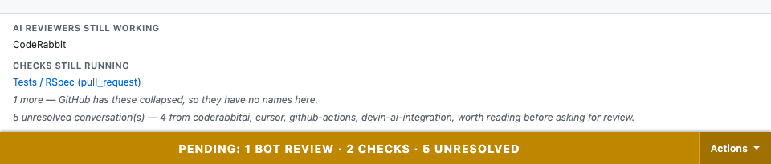
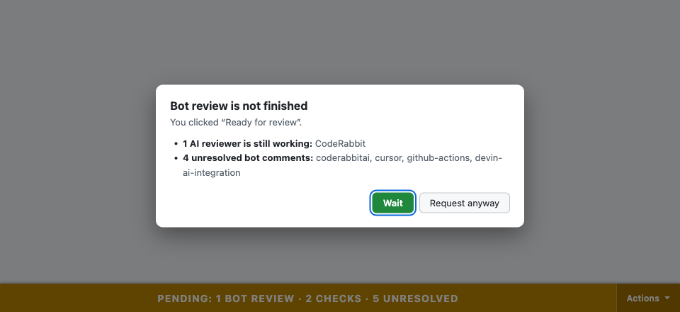
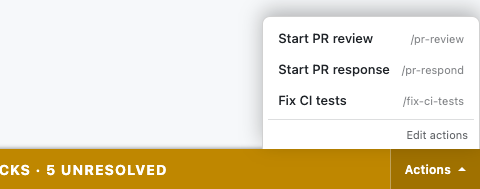
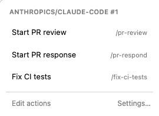

# GitHub Pending Checks Banner

A Chrome extension for GitHub pull requests. It does three things:

- Shows a bar at the bottom of the PR page while checks are running or review
  conversations are unresolved. The bar removes itself once there is nothing left.
- Asks for confirmation when you request review while an AI reviewer (CodeRabbit,
  Devin, and so on) is still working or has left unresolved comments.
- Opens a Claude Code session for the PR, prefilled with `/pr-review`,
  `/pr-respond`, `/fix-ci-tests`, or a skill you add yourself.

It reads the page using your existing GitHub session, so it needs no token and
works on private repos.



## Install

1. Get the zip from whoever shares it, or build it yourself with `npm install && npm run package`.
   That writes `release/github-pending-checks-banner-<version>.zip`.
2. Unzip it somewhere you'll keep it. Chrome loads the extension from that folder, so
   don't delete it afterwards.
3. Open `chrome://extensions`, turn on **Developer mode**, click **Load unpacked**, and
   select the unzipped folder.

To update, replace the folder's contents with the new zip and click the reload icon
on the extension's card.

### Requirements for the session actions

- The Claude desktop app. The actions open `claude://` links, which only the app
  handles.
- The `pr-feedback` and `fix-ci-tests` Claude Code plugins, which provide the
  built-in skills. Without them the session opens but the slash command does not
  resolve.

The banner and the review guard work without either.

## Using it

### The banner

The bar lists what's outstanding, AI reviews first:

```
PENDING: 1 BOT REVIEW · 2 CHECKS · 5 UNRESOLVED
```

Click the bar to see what each item is. Click anywhere else or press Escape to close
it. With nothing pending and nothing unresolved, the bar disappears. It works on the
Files and Commits tabs too, where GitHub doesn't render its own merge box.

### The review guard

Clicking **Ready for review**, the **Reviewers** picker, or **Re-request review**
while an AI reviewer is still running or has unresolved comments shows this first:



**Wait** cancels the click. **Request anyway** lets it through. Ordinary CI doesn't
trigger the guard unless you turn that on in Options, and the guard never fires if
the extension couldn't read the page.

### Session actions

**Actions** on the right of the bar opens a Claude Code session for this PR. The
same list is in the toolbar popup, which you can use when the bar is hidden.

| Bar | Toolbar popup |
| --- | --- |
|  |  |

| Action | Prefilled prompt |
| --- | --- |
| Start PR review | `/pr-review <pr url>` |
| Start PR response | `/pr-respond <pr url>` |
| Fix CI tests | `/fix-ci-tests <pr url>` |

The prompt is prefilled, not sent; press Enter in Claude Code to start. The session
opens in Claude Code's default directory, so the skill may ask which checkout to use.

**Edit actions**, in either list, adds your own: a display name and a skill such as
`/standup` or `/plugin:skill`. Each one runs `<skill> <pr url>`. You can add up to
12, and built-ins can't be changed.

## Options

Right-click the extension icon → **Options**.

| Option | Default | Notes |
| --- | --- | --- |
| Pending re-check interval | 30s | Files/Commits/Checks tabs only, and only while the tab is visible with something pending |
| Confirm before requesting review | on | The review guard |
| …also on unresolved bot comments | on | Bots finished, feedback unread |
| …also for ordinary CI | off | A guard that fires on every lint job gets clicked through |
| AI reviewer name patterns | `coderabbit, devin, warden, claude, copilot, cursor, greptile, bugbot` | Check names containing these count as AI reviews |
| Count reviewers not identifiable as bots | off | Otherwise a pending human review would hold the bar up for the life of the PR |
| Ignore checks containing… | empty | Comma-separated, case-insensitive. Only applies to checks in an expanded group |
| Custom actions | none | Display name + `/skill`. Max 12 |
| Debug logging | off | Logs to the page console with a `[pending-checks]` prefix |

## Known gaps

- A required check that never reports (GitHub's "Expected — Waiting for status")
  keeps the bar up. Add its name to **Ignore checks containing…**.
- Resolving a conversation doesn't update the count until you switch tabs, navigate,
  or refocus the window.
- If GitHub renames **Ready for review** or **Reviewers**, the guard stops firing
  without any error. **Re-request review** hasn't been seen on a real PR yet.
- The `claude://code/new` link is an undocumented route in the Claude desktop app.
  If the actions stop opening anything, the app changed.

[docs/DESIGN.md](docs/DESIGN.md) has the full list, plus how detection works and the
reasons behind each of these choices.

## Development

```bash
npm test          # parser and UI tests over saved fixtures
npm run typecheck
npm run build     # dist/, including the dev harnesses
npm run watch     # rebuild on change; reload the extension card after each one
npm run package   # release/*.zip, without the dev harnesses
```

Load `dist/` unpacked while developing.

### Dev harnesses

Two pages, opened directly after a build. Nothing in the manifest references either.

- **`dist/dev/harness.html`** shows the banner against every saved fixture, with fake
  GitHub controls for the review guard. Custom actions persist in `localStorage`.
- **`dist/dev/popup-harness.html`** runs the real `popup.html` against a stubbed
  `chrome`. Change the URL field to check the non-PR state.

Use them as well as the tests: two action-editor bugs were CSS cascade problems that
jsdom can't catch.

### Screenshots

The images in `docs/screenshots/` come from the harnesses, using the **in flight +
bot comments** fixture at a 960px-wide viewport, light mode, with the harness's own
controls hidden. Retake them when the banner, dialog, or popup changes visibly.

### Fixtures

`test/fixtures/` holds scrubbed merge-box markup. To capture a new one, run this in
the console on a PR:

```javascript
copy(document.querySelector('[data-testid="mergebox-border-container"]').outerHTML)
```

Scrub org/repo names and internal URLs before committing. Raw captures go in
`test/fixtures/raw/`, which is gitignored.
